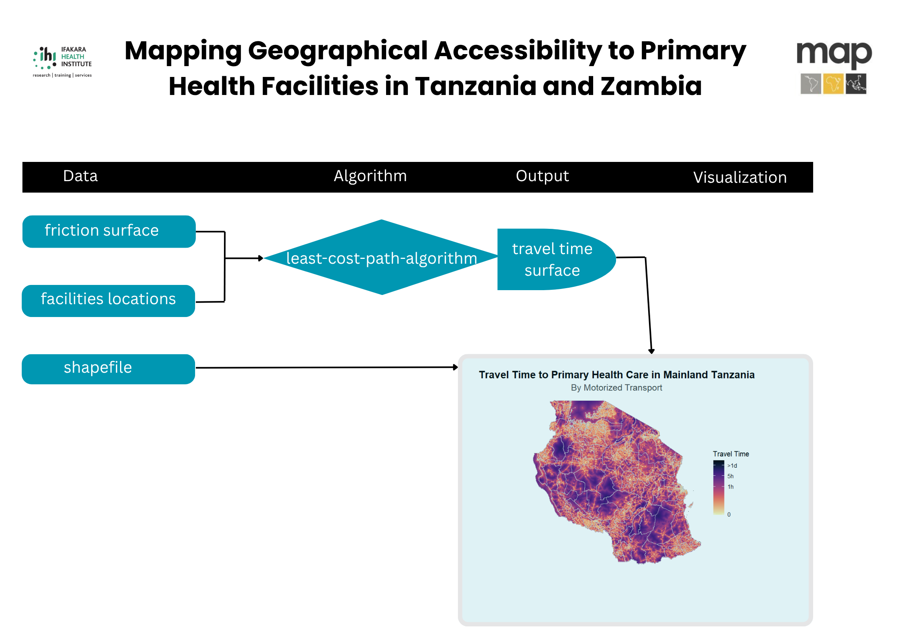

```{r Demo}


```

```{r link to github}

```

```{r libraries}
rm(list=ls())
# Packages
library(gdistance)
library(abind)
library(rje)
library(ggplot2)
library(malariaAtlas)
library(sp)
library(exactextractr)
library(dplyr)
library(readxl)
library(sf)
library(viridis)

```

```{r}
# --- Tanzania (TZA) ---

# Download the Tanzania shape file
TZ.shp <- malariaAtlas::getShp(ISO = "TZA", admin_level = "admin2") %>% 
  dplyr::select(name_1, name_2) 

# Filter only Mainland Tanzania
analysis.shp_TZ <- TZ.shp %>% 
  dplyr::filter(!name_1 %in% c("Kaskazini Pemba",
                              "Kaskazini Unguja",
                              "Kusini Pemba",
                              "Kusini Unguja",
                              "Mjini Magharibi"))
# Check it
plot(analysis.shp_TZ$geometry, main="ADM2 (Councils) Shapefile for Tanzania")
 

```

```{r}

# Motorized friction surface (2020)
motorized_friction <- getRaster(
  dataset_id = "Explorer__2020_motorized_friction_surface",
  shp = analysis.shp_TZ
)


plot(motorized_friction,main="FRICTION SURFACES 2020 Motorized")


```

```{r}

# Walking-only friction surface (2020)
walking_friction <- getRaster(
  dataset_id = "Explorer__2020_walking_only_friction_surface",
  shp = analysis.shp_TZ
)


plot(walking_friction,main="FRICTION SURFACES 2020 Walking")

```

```{r}
# This function calculates travel times
travel_time <- function(friction_surface, loc_points){
  # 1.Convert it to raster object
friction_surface1 <- raster(friction_surface)

# 2.Build transition matrix and geo-correct it---
T <- gdistance::transition(friction_surface1, function(x) 1/mean(x), 8)
T.GC <- gdistance::geoCorrection(T)

# 3.Calculate travel time by motorized 
access.raster <- accCost(T.GC, loc_points)
return(access.raster)
}
```

```{r motorized_travel_times_tza}

# Convert the shapefile to sp object
analysis.shp_TZ_sp <- as_Spatial(analysis.shp_TZ)

# Load the facilities data
tz_facs_2025 <- read_excel("Raw_data/Cleaned_Facility list_Tanzania.xlsx")

# Convert Latitude and Longitude to numeric (coerce invalid entries to NA)
tz_facs_2025 <- tz_facs_2025 %>%
  mutate(
    Latitude = as.numeric(Latitude),
    Longitude = as.numeric(Longitude)
  )

# Filter valid lat/lon (remove NA and impossible values)
tz_facs_2025_clean <- tz_facs_2025 %>%
  filter(!is.na(Latitude), !is.na(Longitude)) %>%
  filter(Latitude >= -90 & Latitude <= 90) %>%
  filter(Longitude >= -180 & Longitude <= 180)

# Convert to sf points
point.locations_tz <- st_as_sf(tz_facs_2025_clean,
                              coords = c("Longitude", "Latitude"),
                              crs = 4326,
                              remove = FALSE)


# Convert to SpatialPointsDataFrame
point.locations_tz_sp <- as(point.locations_tz, "Spatial")


# Make sure projections match
proj4string(point.locations_tz_sp) <- proj4string(analysis.shp_TZ_sp)

# Checking for the facilities outside of the country
overlap_tz <- over(point.locations_tz_sp, analysis.shp_TZ_sp)

# Filter points inside TZ only
point.locations_tz_sp <- point.locations_tz_sp[!is.na(overlap_tz$name_2), ]


# Convert points to matrix for accessibility function
points_tz <- as.matrix(coordinates(point.locations_tz_sp))


# Calculate travel time by motorized 
access.raster.tz_mt <- travel_time(motorized_friction, points_tz)

# Save the travel time by motorized raster
writeRaster(access.raster.tz_mt, "Outputs/motorized_tza.tif", overwrite = TRUE)

```

```{r walking_travel_times_tza}

## Calculate travel time by walking
access.raster.tz_wk <- travel_time(walking_friction, points_tz)

# Save the travel time by walking raster
writeRaster(access.raster.tz_wk, "Outputs/walking_tza.tif", overwrite = TRUE)
```

-   We would like to create the visualization for reporting and presentation

```{r presentation visuals}
# This function will be used to visualize the travel times for both countries
visualize_time <- function(access.raster, shp, country, transport.type){
# 1. Match the CRS  
crs(access.raster) <- crs(shp)

# 2. Replace Inf values with a high number (e.g., 2880 minutes = 2 days)
access.raster[access.raster == Inf] <- 2880

# 3. Replace 0 with 1 (i.e., 1 minute)
access.raster[access.raster == 0] <- 1

# 4. Convert the raster layer to SpatRaster
access.raster2 <- rast(access.raster)

# 5. Crop and mask the raster
access.raster2 <- crop(access.raster2, vect(shp))
access.raster2 <- mask(access.raster2, vect(shp))

# 6. Convert raster to data frame
travel_df <- as.data.frame(access.raster2, xy = TRUE)
colnames(travel_df)[3] <- "travel_time"

# 7. Plotting the map
ggplot() +
  geom_raster(data = travel_df, aes(x = x, y = y, fill = travel_time)) +
  scale_fill_viridis(
    name = "Travel Time",
    trans = "log10",
    breaks = c(1, 60, 300, 1440),
    labels = c("0", "1h", "5h", ">1d"),
    na.value = "transparent",
    option = "magma",
    direction = -1
  ) +
  geom_sf(data = shp, fill = NA, color = "#CCCCCC", linewidth = 0.005, alpha = 0.3) +
  theme_void() +
  labs(title = paste0("Travel Time to Primary Health Care in", " ", country),
       subtitle = paste0("By", " ", transport.type)) +
  theme(
    legend.position = "right",
    plot.title = element_text(size = 16, face = "bold", hjust = 0.5),
    plot.subtitle = element_text(size = 14, color = "grey27", hjust = 0.5)
    
    )
}
```

```{r motorized_visual_tza}
# visualize the travel times by motorized in Tanzania
visualize_time(access.raster.tz_mt, analysis.shp_TZ, "Mainland Tanzania", "Motorized Transport")
```

```{r walking_visual_tza}
# visualize the travel times by walking in Tanzania
visualize_time(access.raster.tz_wk, analysis.shp_TZ, "Mainland Tanzania", "Walking Only")
```

-   Let's estimate the proportion of population within different travel times to healthcare.

```{r travel_time curves}

generate_curves <- function(pop_raster, wk_raster, mt_raster, shp, country){ 
# 1. Convert travel time raster to terra format
wk_raster <- rast(wk_raster)
mt_raster <- rast(mt_raster)

# 2. Convert to SpatVector
shp_vect <- vect(shp)

# 3. Match the CRS
crs(wk_raster) <- crs(pop_raster)
crs(mt_raster) <- crs(pop_raster)
crs(shp_vect) <- crs(pop_raster)

# 4. Crop and Mask the rasters
pop_raster <- crop(pop_raster, shp_vect)
pop_raster <- mask(pop_raster, shp_vect)
wk_raster <- crop(wk_raster, shp_vect)
wk_raster <- mask(wk_raster, shp_vect)
mt_raster <- crop(mt_raster, shp_vect)
mt_raster <- mask(mt_raster, shp_vect)

# 5. Resample population to match travel rasters 
pop_raster <- resample(pop_raster, wk_raster, method = "near")

# 6. Stack and convert to dataframe
stacked <- c(pop_raster, wk_raster, mt_raster)
names(stacked) <- c("pop", "walking", "motorized")

df <- as.data.frame(stacked, xy = FALSE, na.rm = TRUE)

# 7. Filter valid data
df <- df %>% filter(!is.na(pop), !is.na(walking), !is.na(motorized))

# 8. Define time thresholds
thresholds <- seq(10, 180, by = 10)

# 9. Function to compute cumulative share
compute_curve <- function(time_col, label) {
  lapply(thresholds, function(t) {
    data.frame(
      time = t,
      pop_pct = sum(df$pop[df[[time_col]] <= t], na.rm = TRUE) / 
                       sum(df$pop, na.rm = TRUE) * 100,
      mode = label
    )
  }) %>% bind_rows()
}

# 10. Compute curves for both modes
curve_wk <- compute_curve(names(df)[2], names(df)[2])
curve_mt <- compute_curve(names(df)[3], names(df)[3])

# 11. Combine and plot
curve_df <- bind_rows(curve_mt, curve_wk)

p <- ggplot(curve_df, aes(x = time, y = pop_pct, color = mode)) +
  geom_line(size = 1.2) +
  #geom_point() +
  scale_color_manual(values = c("motorized" = "#2C7BB6", "walking" = "brown4")) +
  scale_x_continuous(breaks = thresholds) +
  scale_y_continuous(labels = scales::percent_format(scale = 1)) +
  labs(
    x = "Time (min)",
    y = "Population (%)",
    color = "Mode",
    linetype = "Mode",
    title = "Proportion of Population by Travel Time",
    subtitle = country
  ) +
  theme_minimal()


# 12. Print the plot
print(p)

# 13. Extract cumulative percentages for walking
pct_10_wk <- curve_df %>% filter(time == 10, mode == "walking") %>% pull(pop_pct)
pct_30_wk <- curve_df %>% filter(time == 30, mode == "walking") %>% pull(pop_pct)
pct_60_wk <- curve_df %>% filter(time == 60, mode == "walking") %>% pull(pop_pct)
pct_over_60_wk <- 100 - pct_60_wk

# 14. Extract cumulative percentages for Motorized transport
pct_10_mt <- curve_df %>% filter(time == 10, mode == "motorized") %>% pull(pop_pct)
pct_30_mt <- curve_df %>% filter(time == 30, mode == "motorized") %>% pull(pop_pct)
pct_60_mt <- curve_df %>% filter(time == 60, mode == "motorized") %>% pull(pop_pct)
pct_over_60_mt <- 100 - pct_60_mt

# 15. Get total population
total_pop <- sum(df$pop)

# 16. Function to get pop from percentage
get_pop <- function(pct) round(pct / 100 * total_pop)

# 17. Print results for walking
cat("Access to Healthcare (Walking Time)\n")
cat("----------------------------------\n")
cat("Total population:            ", format(round(total_pop), big.mark = ","), "\n")
cat("Within 10 minutes:           ", get_pop(pct_10_wk), " (", round(pct_10_wk, 1), "%)\n")
cat("Within 30 minutes:           ", get_pop(pct_30_wk), " (", round(pct_30_wk, 1), "%)\n")
cat("Within 1 hour (60 min):      ", get_pop(pct_60_wk), " (", round(pct_60_wk, 1), "%)\n")
cat("Over 1 hour:                 ", get_pop(pct_over_60_wk), " (", round(pct_over_60_wk, 1), "%)\n")
cat("\n")

# 18. Print results for motorized transport
cat("Access to Healthcare (Motorized Transport Time)\n")
cat("----------------------------------\n")
cat("Total population:            ", format(round(total_pop), big.mark = ","), "\n")
cat("Within 10 minutes:           ", get_pop(pct_10_mt), " (", round(pct_10_mt, 1), "%)\n")
cat("Within 30 minutes:           ", get_pop(pct_30_mt), " (", round(pct_30_mt, 1), "%)\n")
cat("Within 1 hour (60 min):      ", get_pop(pct_60_mt), " (", round(pct_60_mt, 1), "%)\n")
cat("Over 1 hour:                 ", get_pop(pct_over_60_mt), " (", round(pct_over_60_mt, 1), "%)\n")

}
```

```{r}
# Estimate the population and visualize
generate_curves(pop_tza, access.raster.tz_wk, access.raster.tz_mt, analysis.shp_TZ, "Mainland Tanzania")
```

```{r}
# --- Zambia (ZMB) ---

# Download the shape file for Zambia
ZMB.shp <- malariaAtlas::getShp(ISO = "ZMB", admin_level = "admin2")

# Keep only adm names
analysis.shp_ZMB <- ZMB.shp %>% dplyr::select(name_1, name_2)

# Check it
plot(analysis.shp_ZMB["name_2"], main="Zambia (Districts)")
 
```

```{r}

# Motorized friction surface (2020)
motorized_friction_zmb <- getRaster(
  dataset_id = "Explorer__2020_motorized_friction_surface",
  shp = analysis.shp_ZMB
)
malariaAtlas::autoplot_MAPraster(motorized_friction_zmb)

# Walking-only friction surface (2020)
walking_friction_zmb <- getRaster(
  dataset_id = "Explorer__2020_walking_only_friction_surface",
  shp = analysis.shp_ZMB
)
malariaAtlas::autoplot_MAPraster(walking_friction_zmb)

```

```{r HFs_preprocess_zmb}
# Convert shape file to sp object
analysis.shp_zmb_sp <- as_Spatial(analysis.shp_ZMB)

# Load point locations for Zambia 
point.locations_zmb <- read_excel("Raw_data/Zambia_Clean_data.xlsx") %>% 
  filter(`Operational status` %in% c("Functional", "Temporarily closure")) %>%
  mutate(District = recode(District,
                           "Chienge" = "Chiengi",
                           "Lavushi Manda" = "Lavushimanda",
                           "Shiwang'andu" = "Shiwang'Andu",
                           "Milenge" = "Milengi",
                           "Shang'ombo" = "Shangombo",
                           "Kapiri-Mposhi" = "Kapiri Mposhi",
                           "Chikankata" = "Chikankanta",
                           "Mushindano" = "Mushindamo"),
  
         Longitude = as.numeric(Longitude),
         Latitude  = as.numeric(Latitude)) %>% 
  filter(!(Longitude == "null" | Latitude == "null" | is.na(Longitude) | is.na(Latitude))) # 86 facilities missed locations

# Change into sf object
point.locations_zmb_sf <- st_as_sf(point.locations_zmb,
                              coords = c("Longitude", "Latitude"),
                              crs = 4326,
                              remove = FALSE)

# Change to sp object
point.locations_zmb_sp <- as_Spatial(point.locations_zmb_sf)

# Match projections

point.locations_zmb_sp <- spTransform(point.locations_zmb_sp,   CRS(proj4string(analysis.shp_zmb_sp)))


# Keep only points inside Zambia shape file
overlap_zmb <- over(point.locations_zmb_sp, analysis.shp_zmb_sp)
point.locations_zmb_sp <- point.locations_zmb_sp[!is.na(overlap_zmb$name_2), ]

# Convert to matrix for accessibility
points_zmb <- as.matrix(coordinates(point.locations_zmb_sp))

```

```{r travel_times_walking_zmb}
# Create travel times by walking in Zambia
access.raster.zmb_wk <- travel_time(walking_friction_zmb, points_zmb)

# Save the travel time by walking raster
writeRaster(access.raster.zmb_wk, "Outputs/walking_zmb.tif", overwrite = TRUE)
```

```{r travel_times_motorized_zmb}

# Create travel times by motorized transport in Zambia
access.raster.zmb_mt <- travel_time(motorized_friction_zmb, points_zmb)

# Save the travel time by walking raster
writeRaster(access.raster.zmb_mt, "Outputs/motorized_zmb.tif", overwrite = TRUE)
```

```{r motorized_visual_zmb}
# visualize the travel times by motorized in Tanzania
visualize_time(access.raster.zmb_mt, analysis.shp_ZMB, "Zambia", "Motorized Transport")
```

```{r walking_visual_zmb}
# visualize the travel times by motorized in Tanzania
visualize_time(access.raster.zmb_wk, analysis.shp_ZMB, "Zambia", "Walking Only")
```

-   We would like to estimate the proportion of population living within different travel times in Zambia.

```{r}
# Estimate the population and visualize
generate_curves(pop_zmb, access.raster.zmb_wk, access.raster.zmb_mt, analysis.shp_ZMB, "Zambia")
```
